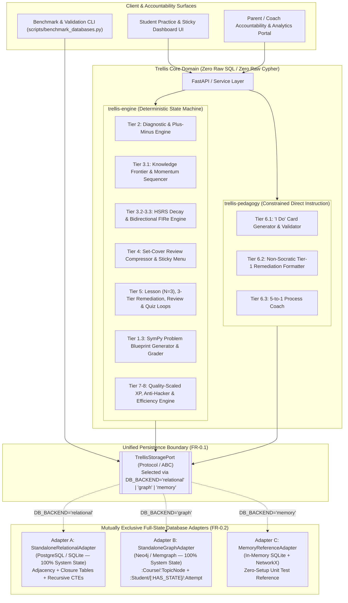

# Trellis System Architecture (`ARCHITECTURE.md`)

## 1. Architectural Overview & Design Principles

Trellis is structured as a **Hexagonal (Ports-and-Adapters) Architecture** governed by three non-negotiable engineering invariants:

1. **Deterministic Authority vs. Constrained Probabilistic Generation:**
   - **`trellis-engine` (Deterministic Core):** All topic state transitions (`LOCKED` $\to$ `AVAILABLE` $\to$ `IN_PROGRESS` $\to$ `MASTERED` $\to$ `DUE_FOR_REVIEW`), HSRS/FIRe memory interval updates, Set-Cover review compression, diagnostic confidence balances, symbolic answer verification (`SymPy`), and XP awards are 100% deterministic mathematical functions.
   - **`trellis-pedagogy` (Constrained Direct-Instruction Layer):** LLMs are used strictly to draft or format "I Do" worked examples, Tier-1 error remediation cards, and John Wooden 5-to-1 process coaching copy, subject to deterministic post-validation. LLMs never mutate student state, schedule queues, or grade answers.

2. **Mutually Exclusive Dual-Backend Persistence (`DB_BACKEND="relational" | "graph" | "memory"`):**
   - To empirically evaluate whether a **100% Standalone Relational DB** or a **100% Standalone Graph DB** is superior for the entire Trellis platform, **zero transactions or queries span across two different database engines**.
   - Every domain service (`Tier 1`–`Tier 8`) communicates exclusively with a single unified port: `TrellisStoragePort`.
   - Each database adapter (`StandaloneRelationalAdapter`, `StandaloneGraphAdapter`, `MemoryReferenceAdapter`) independently stores **100% of the system state** (Curriculum DAG topology, Content Shells, Student Profiles, Topic States, FIRe Credit Ledgers, Sticky Dashboard Menus, and Interaction Telemetry) and executes all multi-hop traversals and ACID mutations on its own.

3. **Curricular Architecture: K–12 Foundations vs. Undergraduate Modular Tracks:**
   - **K–12 School Track & Mathematical Foundations (MF):** Standard cumulative progression (K–12) alongside an accelerated adult/freshman Foundations sequence (`in_foundations_sequence = true`) that filters non-essential topics to rapidly build college STEM prerequisites.
   - **Undergraduate University Track:** Modular, degree-specific courses (`CRS_CALC1` through `CRS_ABSALG`) governed by **Course-Level Mastery Floors** and **Non-Holistic Targeted Remediation** (remediation and diagnostics are strictly confined to the ancestor prerequisite DAG of the enrolled course, preventing inappropriate K–12 high-school regressions).

4. **Decoupled Content Population (Content Shells & Symbolic Blueprints):**
   - Algorithmic execution and topological testing do not wait for bulk prose authoring. Every Knowledge Point (`#kp_0`..`#kp_3`) is hydrated at ingestion with a `KPContentShell` (`BLUEPRINT_READY`) and a deterministic `problem_blueprint` verified by `SymPy`.

---

## 2. Hexagonal System Topology



---

## 3. Topological Build Order (`Tier 0` $\to$ `Tier 8`)

Every module in `src/trellis/` strictly obeys the 9-tier dependency DAG:

| Tier | Architectural Layer | Key Modules (`src/trellis/...`) | Upstream Dependencies |
| :---: | :--- | :--- | :--- |
| **`Tier 0`** | Unified Storage Port, Standalone Adapters, Ingestion & Benchmark | `domain/models.py`, `ports/storage_port.py`, `adapters/db/*`, `services/ingestion_service.py`, `scripts/benchmark_databases.py` | Root (`trellis_knowledge_graph.json`) |
| **`Tier 1`** | Curriculum Topology, Course Tracks & SymPy Blueprint Solver | `engine/topology_service.py`, `engine/content_blueprint_solver.py` | `Tier 0` |
| **`Tier 2`** | Adaptive Placement Diagnostic & Conditional Completion | `engine/diagnostic_engine.py` | `Tier 0`, `Tier 1` |
| **`Tier 3`** | Knowledge Frontier, Learning Speed & Bidirectional HSRS/FIRe | `engine/frontier_service.py`, `engine/hsrs_fire_engine.py` | `Tier 0`, `Tier 1`, `Tier 2` |
| **`Tier 4`** | Set-Cover Review Compression, Non-Interference & Sticky Dashboard | `engine/session_scheduler.py` | `Tier 0`–`Tier 3` |
| **`Tier 5`** | Active Practice Loops (Lessons, 3-Tier Remediation, Reviews, Quizzes) | `engine/practice_evaluator.py` | `Tier 0`–`Tier 4` |
| **`Tier 6`** | Constrained LLM Direct Instruction & 5-to-1 Process Coach | `pedagogy/instruction_coach_service.py` | `Tier 1`, `Tier 5` |
| **`Tier 7`** | Quality-Scaled XP Economy, XP Hacker Defense & Efficiency Projector | `engine/gamification_efficiency.py` | `Tier 5` |
| **`Tier 8`** | Parent/Coach Accountability Portal, Habit Monitor & 95%/99% Analytics | `services/accountability_analytics.py` | `Tier 5`, `Tier 7` |

---

## 4. Directory Layout

```text
trellis/
├── .agents/skills/
│   ├── trellis-engine/             # Deterministic engine skill & contracts
│   └── trellis-pedagogy/           # Direct-instruction pedagogy skill & contracts
├── data/
│   └── clean_spec/
│       └── trellis_knowledge_graph.json  # Clean-room K-12 & Undergraduate Math DAG (v2.0.0-trellis)
├── schemas/
│   └── knowledge_graph_schema.json       # JSON Schema Draft 2020-12 for DAG validation
├── scripts/
│   ├── validate_math_dag.py              # 10-point topological & pedagogical verifier
│   ├── synthesize_clean_graph.py         # Clean-room DAG builder
│   └── benchmark_databases.py            # Head-to-head Relational vs. Graph benchmark (FR-0.4)
├── src/trellis/
│   ├── domain/
│   │   └── models.py                     # Immutable & mutable domain models (Pydantic v2)
│   ├── ports/
│   │   └── storage_port.py               # Unified TrellisStoragePort interface & factory
│   ├── adapters/db/
│   │   ├── standalone_relational_adapter.py  # Adapter A: 100% Standalone Relational DB
│   │   ├── standalone_graph_adapter.py       # Adapter B: 100% Standalone Graph DB
│   │   └── memory_reference_adapter.py       # Adapter C: In-Memory Reference Backend
│   ├── engine/
│   │   ├── topology_service.py           # Tier 1.1-1.2: Dual-edge & course track queries
│   │   ├── content_blueprint_solver.py   # Tier 1.3: SymPy problem generator & grader
│   │   ├── diagnostic_engine.py          # Tier 2: Compressed diagnostic & Plus-Minus balance
│   │   ├── frontier_service.py           # Tier 3.1: Frontier gating & momentum ordering
│   │   ├── hsrs_fire_engine.py           # Tier 3.2-3.3: Learning speed, HSRS & FIRe trickle
│   │   ├── session_scheduler.py          # Tier 4: Set-Cover compression & Sticky Dashboard
│   │   ├── practice_evaluator.py         # Tier 5: Lessons, 3-Tier remediation, Reviews, Quizzes
│   │   └── gamification_efficiency.py    # Tier 7: 6-tier XP, anti-hacker & pace^0.1 efficiency
│   ├── pedagogy/
│   │   └── instruction_coach_service.py  # Tier 6: "I Do" generator, Tier-1 cards, 5-to-1 coach
│   └── services/
│       ├── ingestion_service.py          # Tier 0.3: Clean-room graph ingestion & delta tracker
│       └── accountability_analytics.py   # Tier 8: Parent portal, habit monitor, 95%/99% analytics
└── tests/                                # Parameterized dual-backend parity & tier unit tests
```
