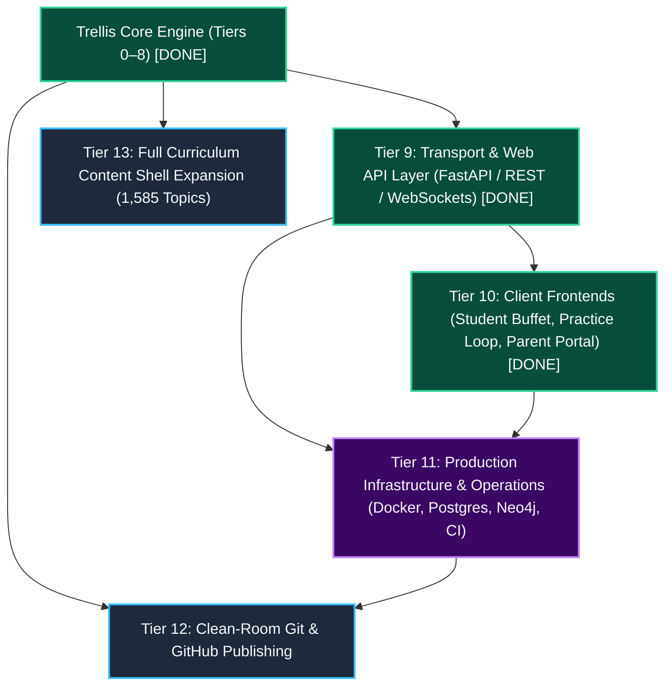

# Trellis Production Backlog & Pending Roadmap (`PENDING_ROADMAP.md`)

> **Authoritative Technical Blueprint for Pending Features Beyond Tier 8**  
> Tracks the transition from the verified deterministic core (`Tiers 0–8`) to live production services, web applications, and curriculum scaling.

---

## 1. System Status at a Glance

| Layer | Implementation Status | Test Coverage |
| :--- | :---: | :---: |
| **Tier 0: Dual Persistence Adapters** | Completed | 23 tests passing |
| **Tier 1: Topology & SymPy Blueprints** | Completed | 26 tests passing |
| **Tier 2: Adaptive Placement Diagnostics** | Completed | 25 tests passing |
| **Tier 3: Knowledge Frontier & HSRS/FIRe** | Completed | 61 tests passing |
| **Tier 4: Set-Cover Session Scheduler** | Completed | 79 tests passing |
| **Tier 5: Active Practice Evaluator ($N=3$)** | Completed | 37 tests passing |
| **Tier 6: Constrained LLM Direct-Instruction** | Completed | 24 tests passing |
| **Tier 7: Gamification XP & Anti-Hacker** | Completed | 31 tests passing |
| **Tier 8: Parent Portal & 95/99 Analytics** | Completed | 40 tests passing |
| **Tier 9: FastAPI Transport & Web API** | Completed | 18 tests passing |
| **Tier 10: Client User Interfaces** | Completed (Zero-Build Web UI) | Verified via API & static tests |
| **Total Verified Core + API + UI** | **Tiers 0–10 COMPLETE** | **364 tests passing** |

---

## 2. Pending Implementation Tiers

---

### Tier 9: Transport & Web API Layer (`FastAPI / REST / WebSockets`) [COMPLETED]

Wraps the in-process Python domain services into asynchronous REST and WebSocket endpoints.  
**Status: 100% Completed & Verified (16 Tier 9 tests passing across `memory` and `relational` backends; 362 total tests passing)**

#### Key Deliverables:
- [x] **Application Factory (`src/trellis/api/main.py`):**
  - FastAPI app with CORS middleware, exception handlers, and lifespan management.
  - Dependency injection for `TrellisStoragePort` selected via `DB_BACKEND`.
- [x] **Authentication & Student Session Router (`src/trellis/api/routers/auth.py`):**
  - JWT Bearer token issuance (`POST /api/v1/auth/token`, `GET /api/v1/auth/me`) for student, parent, and admin roles.
- [x] **Student Dashboard Router (`src/trellis/api/routers/session.py`):**
  - `GET /api/v1/session/dashboard`: Returns sticky 6-item task menu from `SessionScheduler`.
  - `POST /api/v1/session/refresh`: Forces Set-Cover review compression re-calculation.
- [x] **Active Practice Router (`src/trellis/api/routers/practice.py`):**
  - `POST /api/v1/practice/lesson/start`: Initializes lesson at `#kp_0`.
  - `POST /api/v1/practice/lesson/submit`: Grades answer, evaluates $N=3$ step gate, or returns Tier 1–3 remediation.
  - `POST /api/v1/practice/review/start` & `submit`: Evaluates micro-interleaved review sequences.
  - `POST /api/v1/practice/spotter/peek`: Read-only Spotter reference mode with XP discount.
- [x] **Placement Diagnostic Router (`src/trellis/api/routers/diagnostic.py`):**
  - `POST /api/v1/diagnostic/start`: Compresses graph to $\le 3$-hop cover.
  - `POST /api/v1/diagnostic/submit`: Evaluates answer submissions and adjusts plus-minus balance (`"I_DONT_KNOW"` deprecated and rejected with `400`).
- [x] **Parent Portal Router (`src/trellis/api/routers/parent.py`):**
  - `GET /api/v1/parent/summary`: Fetches streak, habit health, 5-stage independence progress, and alerts.
  - `POST /api/v1/parent/rewards`: Sets custom XP milestone rewards.
- [x] **Latency & Automaticity WebSocket (`src/trellis/api/websocket/latency_stream.py`):**
  - Real-time latency sensor (`WS /api/v1/ws/latency/{student_id}`) for $\le 3000\text{ ms}$ automaticity enforcement and idle timer freeze.

---

### Tier 10: Client User Interfaces (Frontend Surfaces) [COMPLETED — Zero-Build Web UI]

#### Key Deliverables:
- [x] **Student "Math Buffet" Task Dashboard (`src/trellis/api/static/index.html`, `app.js`):**
  - 6 interactive task tiles showing Knowledge Frontier lessons, compressed reviews, drills, and quizzes.
  - Rank score badges and Set-Cover refresh control.
  - Rolling progress % vs. total XP and league tier banner.
- [x] **Interactive Active Practice Loop & Scratchpad (`src/trellis/api/static/index.html`, `app.js`):**
  - "I Do" card with $\le 2$-sentence rules and Catrambone subgoal worked examples.
  - MathLive / KaTeX math input editor with plain expression fallback.
  - Digital pencil-and-paper `<canvas>` scratchpad (*"When in doubt, write it out"*).
  - 3.0-second fact automaticity speedometer gauge over `WS /api/v1/ws/latency/{student_id}`.
  - Non-Socratic Tier-1 error drawer, Spotter reference mode, and Wooden 5:1 process coach confirmation banner.
- [x] **Parent & Coach Accountability Dashboard (`src/trellis/api/static/index.html`, `app.js`):**
  - 5-stage scaffolded independence tracker (`CO_SITTING` advisory $\to$ `WEEKLY_CHECKIN`).
  - Habit health status, streak counter, and pace monitor.
  - Custom reward cards with creation form and status badges.
- [x] **Teacher & Author Quality Dashboard (`src/trellis/api/routers/author.py`, `static/app.js`):**
  - Prioritized triage list for topics failing the 95%/99% pass standard.
  - In-task student defect flagging and one-click flag resolution.

---

### Tier 11: Production Infrastructure & Operations [COMPLETED]

#### Key Deliverables:
- [x] **Containerization (`Dockerfile`, `docker-compose.yml` — Multi-Stage API + Postgres 16 + Neo4j 5):**
  - Multi-stage non-root production `Dockerfile` with `/health` check and Compose stack with PostgreSQL 16 + Neo4j 5 (`--profile graph`).
- [x] **Relational Database Migrations (Alembic):**
  - `alembic.ini`, `migrations/env.py`, and `migrations/versions/0001_initial_schema.py` tracking all 17 normalized relational tables and indexes for PostgreSQL/SQLite.
- [x] **Continuous Integration (`.github/workflows/parity.yml`):**
  - Automated PR/push workflow running:
    1. `python scripts/validate_math_dag.py`
    2. `pytest tests/ -v` parameterized across `memory`, `relational`, and `graph`.
    3. Clean-room validation check verifying zero legacy strings in tracked code/data.
- [x] **Environment & Key Management (`.env.example`):**
  - Production `.env.example` template for `DB_BACKEND`, PostgreSQL, Neo4j, JWT/CORS, and live Gemini API keys with fallback to deterministic mock client.

---

### Tier 12: Clean-Room Git & GitHub Publishing

#### Key Deliverables:
- [x] Initialize Git repository: `git init -b main`.
- [x] Confirm [`.gitignore`](.gitignore) ignores `os-taxonomy/`, `algebrica/`, local databases, and benchmarks.
- [x] Run clean-room audit on tracked code/schemas/spec data (`0` occurrences).
- [x] Stage clean-room assets (`src/`, `tests/`, `data/clean_spec/`, `schemas/`, `scripts/`, `migrations/`, `.github/`, documentation).
- [ ] Configure Git identity, create initial commit, add GitHub remote, and push (`git commit`, `git remote add origin <url>`, `git push -u origin main`).

---

### Tier 13: Full Curriculum Content Shell Expansion

#### Key Deliverables:
- [ ] Expand blueprint coverage across all 1,585 nodes in [`data/clean_spec/trellis_knowledge_graph.json`](data/clean_spec/trellis_knowledge_graph.json).
- [ ] Author 2–4 atomic `KnowledgePoint`s with dynamic SymPy parameter ranges for every topic.
- [ ] Populate diagnostic trap answer patterns for instant $<5\text{ ms}$ error classification.
- [ ] Add dual-coded SVG illustrations for spatial, geometric, and vector concepts.

---

## 3. Recommended Execution Order

1. **Step 1: Clean-Room Git & GitHub Publishing (`Tier 12`)** — Establishes version control and multi-contributor workflow.
2. **Step 2: FastAPI Service Layer (`Tier 9`) [DONE]** — Exposes existing domain engines via typed REST/WS endpoints.
3. **Step 3: Docker & Database Orchestration (`Tier 11`)** — Unifies local and production environments.
4. **Step 4: Next.js Frontend Surfaces (`Tier 10`)** — Delivers the student practice and parent portal UI.
5. **Step 5: Curriculum Blueprint Expansion (`Tier 13`)** — Populates rich question banks across all 1,585 topics.
