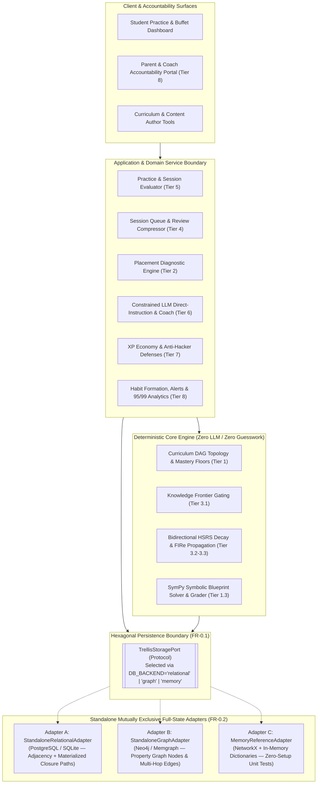

# Trellis K–16 Mathematics Learning Platform

**Trellis** is an adaptive, mastery-based mathematics learning platform spanning Kindergarten arithmetic through university-level undergraduate mathematics (Calculus, Linear Algebra, Real Analysis, Abstract Algebra).

The system is engineered around **Cognitive Load Theory (Sweller, 1988)**, **Direct Instruction (Engelmann)**, and **Hierarchical Spaced Repetition / Fractional Implicit Repetition (Skycak, *The Math Academy Way*)**.

---

## 📚 Essential Documentation

| Document | Purpose |
| :--- | :--- |
| **[`SYSTEM_GUIDE.md`](SYSTEM_GUIDE.md)** | **Authoritative System Manual & Developer Tuning Cookbook.** Complete tier-by-tier feature catalog, symbol locator directory, and step-by-step recipes for modifying algorithms, thresholds, and schemas. |
| **[`ROADMAP.md`](ROADMAP.md)** | **Interactive Tiered Implementation Checklist.** Verification status and test logs for all 9 architectural tiers (`Tier 0` through `Tier 8`). |
| **[`ARCHITECTURE.md`](ARCHITECTURE.md)** | **Hexagonal System Topology & Design Invariants.** Port-and-adapters architecture, dual-backend persistence rules, and clean-room specifications. |
| **[`PRD.md`](PRD.md)** | **Product Requirements Document.** Formal functional requirements (`FR-0.1` through `FR-8.3`) and acceptance criteria. |

---

## 🏛️ System Architecture

Trellis enforces a strict separation between a **deterministic mathematical state machine** and a **constrained direct-instruction layer**, backed by a unified **hexagonal persistence boundary**:



### Core Design Invariants

1. **Deterministic Authority:** Mastery gates ($N=3$), HSRS interval decay ($M = 0.5^{\Delta t / I}$), Set-Cover review compression, diagnostic plus-minus balances, and XP awards are 100% deterministic functions. Probabilistic LLMs are restricted strictly to drafting worked examples ("I Do") and process coaching.
2. **Mutually Exclusive Dual-Backend Persistence:** Zero queries or transactions span two different databases. Runtime selects a single standalone backend via `DB_BACKEND="relational" | "graph" | "memory"`. Every backend independently stores 100% of curriculum graphs, content shells, and student telemetry.
3. **Decoupled Dual-Metric Economy:** Curriculum Progress % ($\text{Mastered} / \text{Total}$) is completely decoupled from Monotonic XP ($1\text{ XP} \approx 1\text{ minute}$ of focused effort). XP cannot buy course progress.
4. **Clean-Room Air-Gap:** Quarantines legacy reference corpora. Production code interacts strictly with clean-room graph schemas (`data/clean_spec/trellis_knowledge_graph.json`).

---

## 🚀 Tiered Implementation Matrix

All 9 tiers are **100% implemented, audited, and verified** across all persistence backends:

| Tier | Focus Area | Status | Key Deliverables |
| :---: | :--- | :---: | :--- |
| **Tier 0** | Dual-Backend Persistence & Benchmark | **`DONE`** | `TrellisStoragePort`, `MemoryReferenceAdapter`, `StandaloneRelationalAdapter`, `StandaloneGraphAdapter`, `benchmark_databases.py` |
| **Tier 1** | Curriculum Topology & SymPy Blueprints | **`DONE`** | `TopologyService`, `ContentBlueprintSolver` (dynamic parameter sampling & AST equivalence grading) |
| **Tier 2** | Adaptive Placement Diagnostics | **`DONE`** | `DiagnosticEngine` ($\le 3$-hop cover, max-entropy selector, signed plus-minus balance, conditional completion) |
| **Tier 3** | Deterministic State Machine & HSRS / FIRe | **`DONE`** | `FrontierService` (100% hard prerequisite gating), `HSRSFIREREngine` (bidirectional FIRe credit & penalty propagation) |
| **Tier 4** | Spaced Repetition Compression & Interleaving | **`DONE`** | `SessionSchedulerService` (NP-hard Set-Cover compression, 70/30 session queue, cluster non-interference) |
| **Tier 5** | Active Learning Execution Loops | **`DONE`** | `PracticeEvaluator` ($N=3$ lesson loop, 3-tier remediation, automaticity sensor $\le 3.0\text{s}$, timed quizzes, test-prep mode) |
| **Tier 6** | Constrained Direct-Instruction Pedagogy | **`DONE`** | `InstructionCoachService` ("I Do" generator, non-Socratic Tier-1 error cards, John Wooden 5:1 process coach) |
| **Tier 7** | Gamification Economy & Anti-Cheat | **`DONE`** | `GamificationEfficiencyEngine` (6-tier quality-scaled XP, anti-hacker defense, efficiency projector, weekly leagues) |
| **Tier 8** | Parent Portal & Content Remediation Analytics | **`DONE`** | `AccountabilityAnalyticsService` (5-stage independence tracker, habit monitor, 95%/99% pass bar analytics, priming cross-check) |

---

## 🛠️ Quickstart & Verification Runbook

### 1. Run Automated Unit & Parity Tests (346 Tests Passing)
```powershell
& "C:\Users\USER\AppData\Roaming\uv\python\cpython-3.15-windows-x86_64-none\python.exe" -m pytest tests/ -v
```

### 2. Validate Mathematical DAG Invariants
```powershell
& "C:\Users\USER\AppData\Roaming\uv\python\cpython-3.15-windows-x86_64-none\python.exe" scripts/validate_math_dag.py
```

### 3. Run Head-to-Head Database Benchmarking Harness
```powershell
& "C:\Users\USER\AppData\Roaming\uv\python\cpython-3.15-windows-x86_64-none\python.exe" scripts/benchmark_databases.py
```

---

## 🔧 Developer Customization & Tuning

Need to adjust the $N=3$ mastery gate, change HSRS decay half-lives, modify the 70/30 session queue ratio, adjust anti-hacker cooldowns, or add a new database table?

👉 See **[`SYSTEM_GUIDE.md`](SYSTEM_GUIDE.md#4-developer-how-to-change-things-tuning-cookbook)** for complete step-by-step recipes with exact file locations and code snippets.
