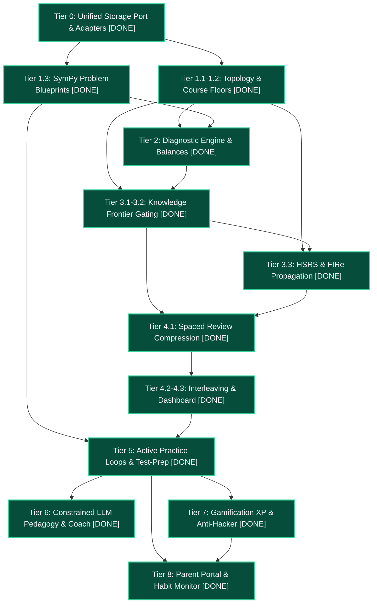

# Trellis K–16 Tiered Implementation Roadmap & Execution Checklist

> [!IMPORTANT]
> **Operational Protocol:** Follow the strict topological dependency order (`Tier 0` $\to$ `Tier 8`). Do not implement downstream features until upstream prerequisites pass automated parity tests. Use **Gemini 3.8 Flash** as the default workhorse; reserve **Argon** specifically for mathematically complex graph algorithms and symbolic solvers.

---

## 1. High-Level Dependency Graph & Model Allocation



---

## 2. Interactive Tier Checklist

### Tier 0: Mutually Exclusive Dual-Backend Persistence Layer (`P0 — Foundation`) [COMPLETED]
*Focus: Hexagonal persistence abstraction, bit-identical dual-backend implementations, clean-room graph ingestion, and head-to-head benchmarking harness.*  
**Status: 100% Completed & Verified (23 tests passing, benchmarks logged)**

- [x] **`FR-0.1` Domain Models & Storage Port Contract**
  - Deliverables: [`src/trellis/domain/models.py`](file:///c:/Users/USER/Desktop/trellis/src/trellis/domain/models.py), [`src/trellis/ports/storage_port.py`](file:///c:/Users/USER/Desktop/trellis/src/trellis/ports/storage_port.py)
  - Pydantic v2 domain schemas (`TopicNode`, `KnowledgePoint`, `StudentProfile`, `StudentTopicState`, `DashboardTaskItem`, `InteractionAttempt`, `XPLedgerEntry`).
  - Abstract `TrellisStoragePort` Protocol defining all curriculum, graph traversal, and student state operations.
  - Runtime factory selecting backend via `DB_BACKEND="relational" | "graph" | "memory"`.
- [x] **`FR-0.2` Independent Full-State Adapters**
  - Deliverables:
    - [`src/trellis/adapters/db/memory_reference_adapter.py`](file:///c:/Users/USER/Desktop/trellis/src/trellis/adapters/db/memory_reference_adapter.py) (In-Memory SQLite + NetworkX reference for tests).
    - [`src/trellis/adapters/db/standalone_relational_adapter.py`](file:///c:/Users/USER/Desktop/trellis/src/trellis/adapters/db/standalone_relational_adapter.py) (100% Relational: SQLite/PostgreSQL with adjacency tables, closure paths, and recursive CTEs).
    - [`src/trellis/adapters/db/standalone_graph_adapter.py`](file:///c:/Users/USER/Desktop/trellis/src/trellis/adapters/db/standalone_graph_adapter.py) (100% Graph: Neo4j/Memgraph with stateful `:HAS_STATE` edges and Cypher traversals).
  - Enforce zero raw queries leaking outside `src/trellis/adapters/db/`.
- [x] **`FR-0.3` Clean-Room Knowledge Graph Ingestion & Diffing Service**
  - Deliverables: [`src/trellis/services/ingestion_service.py`](file:///c:/Users/USER/Desktop/trellis/src/trellis/services/ingestion_service.py)
  - Validates and ingests [`data/clean_spec/trellis_knowledge_graph.json`](file:///c:/Users/USER/Desktop/trellis/data/clean_spec/trellis_knowledge_graph.json) into the active backend.
  - Computes structural delta (`added_nodes`, `rewired_edges`) for supplemental diagnostics.
- [x] **`FR-0.4` Head-to-Head Database Benchmark Harness & Test Suite**
  - Deliverables: [`scripts/benchmark_databases.py`](file:///c:/Users/USER/Desktop/trellis/scripts/benchmark_databases.py), [`tests/test_tier0_persistence.py`](file:///c:/Users/USER/Desktop/trellis/tests/test_tier0_persistence.py), [`tests/test_tier0_ingestion.py`](file:///c:/Users/USER/Desktop/trellis/tests/test_tier0_ingestion.py)
  - Parameterized tests verifying bit-identical parity across `memory`, `relational`, and `graph`.
  - Side-by-side benchmark measuring latency across the 5 canonical workloads (saved to `scripts/benchmark_results.json`).

---

### Tier 1: Curriculum Graph Topology & Decoupled Content Shells (`P0 — Core Domain`) [COMPLETED]
*Focus: Multi-hop graph traversal queries, course tracks, mastery floors, and deterministic SymPy problem blueprints.*  
**Status: 100% Completed & Verified (49 total tests passing across memory, relational, and graph backends)**

- [x] **`FR-1.1` Dual-Edge Graph Traversal Service**
  - Deliverable: [`src/trellis/engine/topology_service.py`](file:///c:/Users/USER/Desktop/trellis/src/trellis/engine/topology_service.py)
  - Methods: `get_hard_parents`, `get_postrequisites`, `get_encompassed_ancestors`, `get_encompassing_descendants`, `get_local_neighborhood`.
- [x] **`FR-1.2` Course Tracks, Core Prioritization & Mastery Floors**
  - Deliverable: [`src/trellis/engine/topology_service.py`](file:///c:/Users/USER/Desktop/trellis/src/trellis/engine/topology_service.py)
  - `is_core` ancestor closure validation, Foundations sequence filter (`in_foundations_sequence = true`), and university mastery floors (`mastery_floor_course_ids`).
- [x] **`FR-1.3` SymPy Problem Blueprint Engine & Symbolic Grader**
  - Deliverable: [`src/trellis/engine/content_blueprint_solver.py`](file:///c:/Users/USER/Desktop/trellis/src/trellis/engine/content_blueprint_solver.py)
  - Dynamic parameter sampling from blueprint constraints.
  - Safe SymPy AST parsing (no insecure `eval()`).
  - Mathematical equivalence grading and trap-pattern misconception matching.

---

### Tier 2: Student Knowledge Profile & Adaptive Placement Diagnostics (`P0 — Placement`) [COMPLETED]
*Focus: Subgraph compression, maximum-entropy question selection, plus-minus signed balances, and conflict resolution.*  
**Status: 100% Completed & Verified (74 total tests passing across memory, relational, and graph backends)**

- [x] **`FR-2.1` Pre-Diagnostic Graph Compression & Max-Entropy Question Selector**
  - Deliverable: [`src/trellis/engine/diagnostic_engine.py`](file:///c:/Users/USER/Desktop/trellis/src/trellis/engine/diagnostic_engine.py)
  - Compresses course + foundations graph into minimal $\le 3$-hop cover.
  - Selects next question maximizing information gain along the ~50% accuracy boundary.
- [x] **`FR-2.2` Plus-Minus Confidence Balance & Conflict Resolution Engine**
  - Deliverable: [`src/trellis/engine/diagnostic_engine.py`](file:///c:/Users/USER/Desktop/trellis/src/trellis/engine/diagnostic_engine.py)
  - Accuracy-Time Conflict discounting ($+1.0 \to +0.15$ for overtime answers).
  - Explicit `"I_DONT_KNOW"` flag records $-1.0$ weight immediately.
  - Causal (ancestors) and correlational (module leaf siblings) propagation.
  - Prerequisite-Postrequisite conflict resolution (places student at bottom of lowest hole).
- [x] **`FR-2.3` Conditional Completion, Supplemental Diagnostics & "I Already Know This" Fast-Track**
  - Deliverable: [`src/trellis/engine/diagnostic_engine.py`](file:///c:/Users/USER/Desktop/trellis/src/trellis/engine/diagnostic_engine.py)
  - Marks topics with $0.0 < \text{balance} < 1.0$ as conditionally completed.
  - Revokes credit cascadingly upon downstream failure.
  - Fast-track lesson bypass via 2 unassisted highest-KP questions.

---

### Tier 3: Deterministic Mastery State Machine & HSRS / FIRe (`P0 — Algorithmic Core`) [COMPLETED]
*Focus: Hard prerequisite unlock, student-topic learning speed, memory decay, and bidirectional FIRe propagation.*  
**Status: Implemented, Audited by Argon & Verified (135 total tests passing across memory, relational, and graph backends)**  
**Recommended Model: Gemini 3.8 Flash (FR-3.1–3.2) / Flash Draft + Argon Review (FR-3.3)**

- [x] **`FR-3.1` Knowledge Frontier Calculation & Foundational Momentum Sequencer**
  - Deliverable: [`src/trellis/engine/frontier_service.py`](file:///c:/Users/USER/Desktop/trellis/src/trellis/engine/frontier_service.py)
  - Unlocks `LOCKED` $\to$ `AVAILABLE` strictly when 100% of incoming hard prerequisites are `MASTERED` (with automatic `AVAILABLE` $\to$ `LOCKED` re-locking on conditional completion revocation and Local Neighborhood ability initialization on unlock).
  - Prioritizes topics in enrolled course before dropping to lower-grade foundational gaps.
- [x] **`FR-3.2` Student-Topic Learning Speed Calibration & Preventative Remediation Gate**
  - Deliverable: [`src/trellis/engine/hsrs_fire_engine.py`](file:///c:/Users/USER/Desktop/trellis/src/trellis/engine/hsrs_fire_engine.py)
  - Computes $\text{speed} = \text{ability} / \text{difficulty} \in [0.25, 2.50]$ via EWMA with $(\max, \times)$ semiring deduplication across diamond DAG neighborhoods.
  - Blocks implicit FIRe credit when $\text{speed} < 1.0$ to force explicit spaced reviews.
- [x] **`FR-3.3` HSRS Memory Decay & Bidirectional FIRe Propagation Engine** *(Argon Audited & Hardened)*
  - Deliverable: [`src/trellis/engine/hsrs_fire_engine.py`](file:///c:/Users/USER/Desktop/trellis/src/trellis/engine/hsrs_fire_engine.py)
  - Calculates memory strength $M = (0.5)^{\Delta t / I}$ and flags `DUE_FOR_REVIEW` when $M \le 0.50$.
  - Downward FIRe trickle-down on pass: $\Delta C = \text{effective\_delta} \times \max_{\text{paths}}(\prod w_i)$ with $\epsilon = 10^{-6}$ floating-point trigger tolerance and early-review interval scaling.
  - Upward penalty trickle-up on fail with accelerated summer slide decay ($\text{decay} \in [1.0, 5.0]$), $I \ge 0.5\text{ days}$ floor, elapsed-time memory accounting, and stale fractional credit reset.

---

### Tier 4: Spaced Repetition Compression, Interleaving & Sticky Dashboard (`P1 — Scheduling`) [COMPLETED]
*Focus: NP-hard Set-Cover review compression, non-interference macro-interleaving, and sticky task menus.*  
**Status: 100% Completed & Verified (214 total tests passing across memory, relational, and graph backends, Workload W6 benchmarked)**  

- [x] **`FR-4.1` Spaced Repetition Compression Set-Cover Optimizer**
  - Deliverable: [`src/trellis/engine/session_scheduler.py`](file:///c:/Users/USER/Desktop/trellis/src/trellis/engine/session_scheduler.py)
  - Submodular marginal credit gain: $\Delta f(c \mid \text{acc}) = \sum \min(1.0 - \text{acc}[r], \text{flow}(c \to r))$ with Wolsey greedy selection and reverse redundancy pruning.
  - Look-ahead fending for upcoming reviews with memory in $(0.50, 0.70]$ via interval expansion or memory replenishment above $0.70$.
  - 3-tier kind priority: `FRONTIER_LESSON > DUE_REVIEW > MASTERED_REVIEW` with exact HSRS ancestor pool invalidation on credit crossing $1.0$.
  - Sub-50ms execution verified on 1,585-node DAG ($8.1\text{ ms}$ memory, $42.4\text{ ms}$ relational).
- [x] **`FR-4.2` Macro-Interleaving, Non-Interference & Review-Tsunami Throttle**
  - Deliverable: [`src/trellis/engine/session_scheduler.py`](file:///c:/Users/USER/Desktop/trellis/src/trellis/engine/session_scheduler.py)
  - Enforces 70% Frontier / 30% Review split with 25% minimum lesson floor during review waves.
  - Simultaneous dashboard cluster non-interference (`MENU` mode) and consecutive cluster non-interference with Pigeonhole majority rule (`SEQUENCE` mode).
  - Controlled bottleneck relaxation when tasks are confined to a single prerequisite cluster.
- [x] **`FR-4.3` Sticky "Math Buffet" Task Dashboard Manager**
  - Deliverable: [`src/trellis/engine/session_scheduler.py`](file:///c:/Users/USER/Desktop/trellis/src/trellis/engine/session_scheduler.py)
  - Ranks dashboard tasks by composite Importance combining knockout count, fending credit, downstream dependents, enrolled momentum, core status, and review urgency.
  - Enforces deterministic menu stickiness: lessons remain until completed or invalidated; reviews remain until completed or implicitly knocked out.
  - Opaque retention of Tier-5 task types (`TARGETED_REMEDIATION`, `FACT_FLUENCY`, `TIMED_QUIZ`).

---

### Tier 5: Active Learning Execution Loops (`P1 — Student Experience`) [COMPLETED]
*Focus: Lesson staircase ($N=3$), 3-tier targeted remediation, micro-interleaved reviews, automaticity sensors, timed quizzes, multi-part synthesis, and test-prep mode.*  
**Status: 100% Completed & Verified (37 Tier 5 tests passing across memory, relational, graph, and bit-identical parity)**

- [x] **`FR-5.1` Hyper-Scaffolded Lesson Loop & $N=3$ Mastery Gate**
  - Deliverable: [`src/trellis/engine/practice_evaluator.py`](file:///c:/Users/USER/Desktop/trellis/src/trellis/engine/practice_evaluator.py)
  - Steps through sequential KPs (`#kp_0`..`#kp_2`). Requires $N=3$ unassisted correct answers.
  - Expertise Reversal bypass for pre-placement diagnostic accuracy $\ge 0.90$.
- [x] **`FR-5.2` 3-Tier Targeted Remediation Engine**
  - Deliverable: [`src/trellis/engine/practice_evaluator.py`](file:///c:/Users/USER/Desktop/trellis/src/trellis/engine/practice_evaluator.py)
  - Tier 1: 1st error resets counter, triggers remediation card, serves fresh parameterized variant.
  - Tier 2: Attempt budget halt with consolidation cooldown timestamp (`cooldown_until`).
  - Tier 3: 2nd error at identical KP halts lesson to `key_prerequisite_id` remedial review, unblocking or peeling back on pass/fail.
- [x] **`FR-5.3` Micro-Interleaved Spaced Review Loop & "Spotter" Reference Mode**
  - Deliverable: [`src/trellis/engine/practice_evaluator.py`](file:///c:/Users/USER/Desktop/trellis/src/trellis/engine/practice_evaluator.py)
  - Exact sequence grading matching *The Math Academy Way* (`✖✔✖✔✔` passes; `✔✔✖✔✖` fails; $\ge 3$ errors immediate failure).
  - Read-only Spotter mode requires locked problem inputs and applies multiplicative discount ($0.5^\text{peeks}$) to `rawDelta`.
- [x] **`FR-5.4` Automaticity Latency Sensor ($\le 3.0\text{s}$) & Fact Retrieval Drills**
  - Deliverable: [`src/trellis/engine/practice_evaluator.py`](file:///c:/Users/USER/Desktop/trellis/src/trellis/engine/practice_evaluator.py)
  - Enforces $\le 3000\text{ ms}$ ceiling on `FLUENCY_FACT` / automaticity nodes.
  - Detects slow plateau (3 consecutive slow responses) and injects speed-gated fact fluency drills.
- [x] **`FR-5.5` Timed Interleaved Quizzes & Retakes**
  - Deliverable: [`src/trellis/engine/practice_evaluator.py`](file:///c:/Users/USER/Desktop/trellis/src/trellis/engine/practice_evaluator.py)
  - Schedules quizzes every 100–150 XP calibrated to 80–85% target score band.
  - Missed quiz topics trickle downward HSRS penalty and lock retake quiz until all targeted remedial reviews pass.
- [x] **`FR-5.6` Multi-Part Synthesis Problems & Test-Prep Mode**
  - Deliverable: [`src/trellis/engine/practice_evaluator.py`](file:///c:/Users/USER/Desktop/trellis/src/trellis/engine/practice_evaluator.py)
  - Multi-part applied synthesis with sequential unlocking and granular component topic failure attribution.
  - Toggleable Test-Prep Mode pauses course promotion, sweeps peak freshness ($M \le 0.85$), serves cumulative exams every 500 XP with longitudinal slicing, and enforces 1d $\to$ 3d $\to$ 7d spaced re-attempts restarting from Day 1 on failure.

---

### Tier 6: Constrained LLM Direct-Instruction & Process Coaching (`P1/P2 — Pedagogy`) [COMPLETED]
*Focus: "I Do" generation, non-Socratic Tier-1 error cards, and John Wooden 5-to-1 process coach.*  
**Status: 100% Completed & Verified (24 Tier 6 tests passing across memory, relational, graph, and bit-identical parity)**

- [x] **`FR-6.1` "I Do" Direct Instruction Generator & Validator**
  - Deliverable: [`src/trellis/pedagogy/instruction_coach_service.py`](file:///c:/Users/USER/Desktop/trellis/src/trellis/pedagogy/instruction_coach_service.py)
  - Validates $\le 2$-sentence rule statements, $\le 4$ novel chunks, 1 worked example, zero Socratic questions.
- [x] **`FR-6.2` Non-Socratic Tier-1 Precision Remediation Engine**
  - Deliverable: [`src/trellis/pedagogy/instruction_coach_service.py`](file:///c:/Users/USER/Desktop/trellis/src/trellis/pedagogy/instruction_coach_service.py)
  - Fast-path misconception lookup ($<5\text{ ms}$) or constrained LLM formatting.
- [x] **`FR-6.3` John Wooden 5-to-1 In-Task Process Coach**
  - Deliverable: [`src/trellis/pedagogy/instruction_coach_service.py`](file:///c:/Users/USER/Desktop/trellis/src/trellis/pedagogy/instruction_coach_service.py)
  - Logs 5 process-grounded acknowledgments per 1 correction. Bans ability praise and excusing slips.

---

### Tier 7: Gamification Economy & Anti-Cheat XP Hacker Defenses (`P2 — Incentives`) [COMPLETED]
*Focus: Quality-scaled XP, anti-cheat detection, and $(\text{pace}/40)^{0.1}$ efficiency curve.*  
**Status: 100% Completed & Verified (31 Tier 7 tests passing across memory, relational, graph, and bit-identical parity; 306 total repo tests passing)**

- [x] **`FR-7.1` XP-Time Equivalence ($1\text{ XP} \approx 1\text{ Min}$) & 6-Tier Quality Scaling**
  - Deliverable: [`src/trellis/engine/gamification_efficiency.py`](file:///c:/Users/USER/Desktop/trellis/src/trellis/engine/gamification_efficiency.py)
  - Scales base XP across 6 quality tiers: Bonus ($1.25\times$), Full ($1.0\times$), Most ($0.75\times$), Little ($0.25\times$), Zero ($0\times$), and Negative Penalty ($<0$).
- [x] **`FR-7.2` Anti-Loophole & "XP Hacker" Defense System**
  - Deliverable: [`src/trellis/engine/gamification_efficiency.py`](file:///c:/Users/USER/Desktop/trellis/src/trellis/engine/gamification_efficiency.py)
  - Negative XP penalties for rapid blow-offs ($<20\%$ expected time) with escalating severity ($-2, -4, -6\text{ XP}$), 15-minute cooldown hold, and idle timer freezes ($>3 \times \text{median\_latency}$).
- [x] **`FR-7.3` Decoupled Course Progress % vs. XP & Learning Efficiency Projector**
  - Deliverable: [`src/trellis/engine/gamification_efficiency.py`](file:///c:/Users/USER/Desktop/trellis/src/trellis/engine/gamification_efficiency.py)
  - Computes `progress_pct` strictly from mastered course nodes vs. total course nodes (Invariant 8). Tracks rolling weekday `pace` (with $15\text{ XP/weekday}$ viability warning and $90\text{ XP/day}$ burnout warning) and projects course completion via $(\text{pace}/40)^{0.1}$.
- [x] **`FR-7.4` Ability-Grouped Weekly Leagues**
  - Deliverable: [`src/trellis/engine/gamification_efficiency.py`](file:///c:/Users/USER/Desktop/trellis/src/trellis/engine/gamification_efficiency.py)
  - Groups opted-in students into 20–30 learner weekly cohorts matched by pace across 5 distinctive scholastic tiers (`APPRENTICE` $\to$ `PRACTITIONER` $\to$ `SCHOLAR` $\to$ `FELLOW` $\to$ `POLYMATH`), ranks strictly by Net Weekly XP, and executes Sunday settlement promoting top 20% and demoting bottom 20%.

---

### Tier 8: Parent Portal, Habit Formation & Content Remediation Analytics (`P3 — Analytics`) [COMPLETED]
*Focus: Accountability portal, 5-stage scaffolded independence tracker, and 95%/99% content bar.*  
**Status: 100% Completed & Verified (40 Tier 8 tests passing across memory, relational, and graph backends; 346 total repo tests passing)**

- [x] **`FR-8.1` Parent / Coach Accountability Portal & 5-Stage Independence Tracker**
  - Deliverable: [`src/trellis/services/accountability_analytics.py`](file:///c:/Users/USER/Desktop/trellis/src/trellis/services/accountability_analytics.py)
  - `CO_SITTING` $\to$ `WEEKLY_CHECKIN` transitions (with co-sitting as an optional, non-punitive coaching advisory) and Adult Re-Sit alerts.
  - Binds custom parent rewards to cumulative XP targets.
- [x] **`FR-8.2` Contextual Habit Formation & Minimum Pace Monitor**
  - Deliverable: [`src/trellis/services/accountability_analytics.py`](file:///c:/Users/USER/Desktop/trellis/src/trellis/services/accountability_analytics.py)
  - Anchors daily study windows, tracks window adherence and streaks.
  - Warns on $<15\text{ XP/weekday}$ viability floor or $>90\text{ XP/day}$ burnout ceiling.
- [x] **`FR-8.3` Granular Content Remediation Analytics (`95% / 99%` Pass Bar)**
  - Deliverable: [`src/trellis/services/accountability_analytics.py`](file:///c:/Users/USER/Desktop/trellis/src/trellis/services/accountability_analytics.py)
  - Flags topics/KPs with 1st-attempt pass rate $<95\%$ or 2-attempt pass rate $<99\%$.
  - Cross-checks lesson pass rates against unprimed Review/Quiz retention to detect superficial priming.
  - In-task student/parent defect flagging and author remediation queue.

---

## 3. Verification Protocol

Run these commands to verify each tier's completion:
```powershell
# 1. Topological & DAG Invariant Check
& "C:\Users\USER\AppData\Roaming\uv\python\cpython-3.15-windows-x86_64-none\python.exe" scripts/validate_math_dag.py

# 2. Automated Parity Unit Tests (Across all backends)
& "C:\Users\USER\AppData\Roaming\uv\python\cpython-3.15-windows-x86_64-none\python.exe" -m pytest tests/ -v

# 3. Head-to-Head Relational vs. Graph Database Benchmark
& "C:\Users\USER\AppData\Roaming\uv\python\cpython-3.15-windows-x86_64-none\python.exe" scripts/benchmark_databases.py
```
