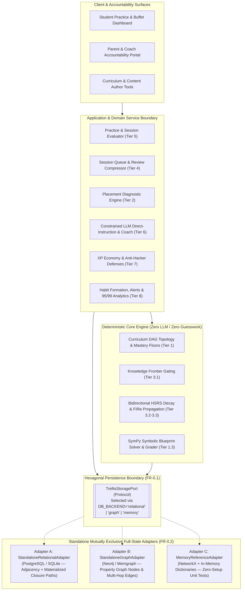

# Trellis System Architecture, Feature Catalog & Developer Modification Manual (`SYSTEM_GUIDE.md`)

> **Authoritative System Guide for Trellis K–16 Platform**  
> *Engineered around Cognitive Load Theory (Sweller, 1988) and Hierarchical Spaced Repetition / Fractional Implicit Repetition (Skycak, The Math Academy Way).*

---

## 1. System Philosophy & High-Level Architecture

Trellis is an adaptive, mastery-based mathematics learning engine that spans Kindergarten arithmetic through university-level undergraduate mathematics (Calculus, Linear Algebra, Real Analysis, Abstract Algebra).



### Core Architectural Invariants

1. **Deterministic Authority vs. Constrained Probabilistic Pedagogy:**
   - **Deterministic State Machine (`trellis-engine`):** Mastery gating, spaced repetition intervals, task scheduling, diagnostic plus-minus weights, anti-cheat detection, and XP calculations are governed strictly by deterministic mathematical algorithms.
   - **Constrained Pedagogical Layer (`trellis-pedagogy`):** Large Language Models (LLMs) are restricted exclusively to drafting worked examples ("I Do"), non-Socratic misconception remediation explanations, and process-grounded praise. LLMs are never permitted to determine student status, alter intervals, grade answers, or schedule practice queues.
2. **Mutually Exclusive Dual-Backend Persistence (`DB_BACKEND="relational" | "graph" | "memory"`):**
   - Every domain service interacts with persistence exclusively through `TrellisStoragePort` ([`src/trellis/ports/storage_port.py`](file:///c:/Users/USER/Desktop/trellis/src/trellis/ports/storage_port.py)).
   - Zero queries span multiple databases simultaneously. Each adapter independently stores 100% of curriculum graphs, content shells, student states, and telemetry.
   - Zero raw SQL and zero raw Cypher leak outside [`src/trellis/adapters/db/`](file:///c:/Users/USER/Desktop/trellis/src/trellis/adapters/db/).
3. **Decoupled Metric Economy:**
   - **Curriculum Progress %** is strictly the ratio of mastered course nodes to total course nodes ($\text{Mastered} / \text{Total}$).
   - **Monotonic XP** represents focused cognitive work ($1\text{ XP} \approx 1\text{ minute}$ of effort). XP cannot buy curriculum progress.
4. **Clean-Room Specification:**
   - Legacy directories (`algebrica/`, `os-taxonomy/`) are air-gapped references. Production code interacts exclusively with clean-room schemas ([`data/clean_spec/trellis_knowledge_graph.json`](file:///c:/Users/USER/Desktop/trellis/data/clean_spec/trellis_knowledge_graph.json)).

---

## 2. Complete Tier-by-Tier Feature Catalog

### Tier 0: Hexagonal Persistence Layer & Benchmark Harness
* **Unified Interface (`FR-0.1`):** `TrellisStoragePort` Protocol defines methods covering curriculum ingestion, DAG traversals, content shells, and student state transactions.
* **Three Standalone Adapters (`FR-0.2`):**
  - **Adapter A (`StandaloneRelationalAdapter`):** Uses SQLite/PostgreSQL with recursive CTEs (`WITH RECURSIVE`) and materialized `topic_closure_paths`.
  - **Adapter B (`StandaloneGraphAdapter`):** Uses Neo4j/Memgraph property graphs with `:TopicNode`, `:KnowledgePoint`, `:Student`, `[:HAS_STATE]`, and `:Attempt` nodes.
  - **Adapter C (`MemoryReferenceAdapter`):** In-memory reference backend using NetworkX graphs and dictionaries for zero-setup, lightning-fast unit tests.
* **Ingestion & Version Delta Tracker (`FR-0.3`):** Validates the clean DAG via [`scripts/validate_math_dag.py`](file:///c:/Users/USER/Desktop/trellis/scripts/validate_math_dag.py) and computes structural deltas (`added_nodes`, `rewired_edges`) for supplemental diagnostics.
* **Head-to-Head Benchmarking (`FR-0.4`):** [`scripts/benchmark_databases.py`](file:///c:/Users/USER/Desktop/trellis/scripts/benchmark_databases.py) executes 6 canonical workloads side-by-side:
  - W1: Knowledge Frontier Scan
  - W2: Multi-Hop FIRe Propagation
  - W3: Set-Cover Review Compression
  - W4: Diagnostic Plus-Minus Propagation
  - W5: Concurrent Submission Writes
  - W6: Session Scheduler Queue Refresh

---

### Tier 1: Curriculum DAG Topology & SymPy Problem Blueprints
* **Dual-Edge Graph Traversals (`FR-1.1`):**
  - **Prerequisites ($G_{\text{prereq}}$):** Forward gating edges ($u \to v$). `get_hard_parents(v)` returns topics that must be mastered before $v$ unlocks.
  - **Encompassings ($G_{\text{enc}}$):** Backward repetition containment edges ($v \to u$). `get_encompassed_ancestors(v)` returns topics that receive implicit practice when $v$ is solved.
  - `get_local_neighborhood(v)` extracts direct prereqs, key prereqs, encompassings, and same-module cluster siblings.
* **Course Tracks & Mastery Floors (`FR-1.2`):**
  - **Core Prioritization:** Enforces Core Ancestor Closure (`is_core = True`).
  - **Mathematical Foundations (MF):** Filters the K–12 graph to `in_foundations_sequence = True` for accelerated adult STEM remediation.
  - **Mastery Floors:** Topics in `mastery_floor_course_ids` are credited as `MASTERED_FLOOR`. University remediation is strictly confined to ancestor prerequisites of the enrolled course.
* **SymPy Problem Blueprint Engine & Grader (`FR-1.3`):**
  - Parameter sampling DSL generates randomized numeric/algebraic variants.
  - AST parsing without insecure `eval()`.
  - Grades mathematical equivalence symbolically using SymPy (`sympy.simplify(student - expected) == 0`).
  - Trap-pattern misconception matching identifies specific distractors.

---

### Tier 2: Adaptive Placement Diagnostic & Signed Balances
* **Pre-Diagnostic Graph Compression (`FR-2.1`):** Compresses the enrolled course and foundations subgraph into a minimal $\le 3$-hop cover.
* **Max-Entropy Question Selector (`FR-2.1`):** Selects questions along the $\sim 50\%$ accuracy boundary to maximize expected information gain across 20–60 items.
* **Plus-Minus Confidence Balance (`FR-2.2`):**
  - Signed balance tracking per topic.
  - **Accuracy-Time Conflict Discounting:** Overtime correct answers ($t > t_{\text{expected}}$) decay from $+1.0 \to +0.15$ to penalize slow recalculation over automatic retrieval.
  - **"I Don't Know" Action:** Immediately records a clean $-1.0$ weight without distortion.
  - **Causal & Correlational Propagation:** Positive weight flows backward to ancestors and sideways to leaf siblings; negative weight flows forward to postrequisites.
  - **Lowest Knowledge Hole:** Places student at the bottom of their deepest prerequisite deficiency.
* **Conditional Completion & Fast-Track (`FR-2.3`):**
  - $0.0 < \text{balance} < 1.0 \implies \text{MASTERED}$ with `is_conditionally_completed = True`. Subsequent failure cascades credit revocation.
  - **"I Already Know This" Bypass:** Allows students to skip lessons via 2 unassisted highest-KP questions answered within expected time.

---

### Tier 3: Deterministic Mastery State Machine & HSRS / FIRe
* **Knowledge Frontier Calculation (`FR-3.1`):**
  - Unlocks `LOCKED` $\to$ `AVAILABLE` strictly when 100% of incoming hard prerequisites evaluate to `MASTERED` or `MASTERED_FLOOR`.
  - Automatically re-locks to `LOCKED` if conditional completion is revoked.
* **Learning Speed Calibration (`FR-3.2`):**
  - Computes $\text{speed} = \text{ability} / \text{difficulty} \in [0.25, 2.50]$ via EWMA with $(\max, \times)$ semiring deduplication across diamond DAG neighborhoods.
  - When $\text{speed} < 1.0$, blocks implicit repetition credit to enforce explicit spaced reviews.
* **Hierarchical Spaced Repetition (HSRS) Memory Decay (`FR-3.3`):**
  - Calculates memory strength: $M = (0.5)^{\Delta t / I}$, where $\Delta t$ is elapsed time and $I$ is the stability interval (days).
  - Flags topic as `DUE_FOR_REVIEW` when $M \le 0.50$.
* **Bidirectional FIRe Propagation (`FR-3.3`):**
  - **Downward FIRe Trickle-Down (Pass):** Passing an advanced topic distributes fractional credit ($\Delta C = w$) backward to mastered ancestors up to 2 hops. When $\sum \Delta C \ge 1.0$, interval expands:
    $$I_{k+1} = I_k \times \left(1.0 + 0.5 \cdot \frac{\text{student\_ability}}{\text{topic\_difficulty}}\right)$$
  - **Upward Penalty Trickle-Up (Fail):** Failing a topic decays encompassing descendants up to 2 hops, with accelerated summer slide decay ($\text{decay} \in [1.0, 5.0]$) and $I \ge 0.5\text{ days}$ hard floor.

---

### Tier 4: Spaced Review Compression, Interleaving & Sticky Dashboard
* **Submodular Set-Cover Review Optimizer (`FR-4.1`):**
  - Formulates spaced repetition as a submodular Set-Cover problem.
  - Greedily selects candidate topics maximizing Wolsey marginal gain into due reviews:
    $$\Delta f(c \mid \text{acc}) = \sum_{r \in \text{uncovered}} \min(1.0 - \text{acc}[r], \text{flow}(c \to r))$$
  - Look-ahead fending protects upcoming reviews with memory in $(0.50, 0.70]$.
  - Priority ordering: `FRONTIER_LESSON` (2) > `DUE_REVIEW` (1) > `MASTERED_REVIEW` (0).
* **Macro-Interleaving & Review-Tsunami Throttle (`FR-4.2`):**
  - Target ratio: **70% Knowledge Frontier Lessons / 30% Spaced Reviews**.
  - During review tsunamis, enforces a **25% minimum lesson floor** (never drops to 100% review).
  - Cluster Non-Interference: Adjacent or simultaneous tasks cannot share the same `domain_cluster` to prevent blocked practice.
* **Sticky "Math Buffet" Task Dashboard (`FR-4.3`):**
  - Ranks tasks by composite importance: knockout count ($10\times$), fending credit ($3\times$), enrolled momentum ($2\times$), review urgency ($2\times$), and core status ($1\times$).
  - Sticky retention: lessons remain until completed; reviews remain until explicitly solved or implicitly knocked out.

---

### Tier 5: Active Practice Execution Loops
* **Hyper-Scaffolded Lesson Loop ($N=3$ Gate) (`FR-5.1`):**
  - Steps through atomic Knowledge Points (`#kp_0`..`#kp_3`).
  - Advances to next KP strictly after $N=3$ consecutive unassisted correct answers.
  - Expertise Reversal bypass if placement diagnostic accuracy $\ge 0.90$.
* **3-Tier Targeted Remediation Engine (`FR-5.2`):**
  - **Tier 1 (1st Error):** Resets consecutive correct counter to 0, delivers a non-Socratic remediation card, serves a fresh parameterized variant.
  - **Tier 2 (Attempt Budget Exhausted):** Halts lesson with consolidation cooldown timestamp (`cooldown_until`).
  - **Tier 3 (2nd Error at Same KP):** Halts lesson and routes student to remedial review of `key_prerequisite_id`.
* **Micro-Interleaved Review & Spotter Mode (`FR-5.3`):**
  - Strict grading: `✖✔✖✔✔` passes; `✔✔✖✔✖` fails; $\ge 3$ errors immediate failure.
  - Read-only Spotter reference mode applies multiplicative penalty ($0.5^{\text{peeks}}$) to XP.
* **Automaticity Latency Sensor ($\le 3.0\text{s}$) (`FR-5.4`):**
  - Verifies retrieval speed $\le 3000\text{ ms}$ on atomic fact items.
  - Injects speed-gated fact fluency drills if slow plateau is detected (3 consecutive slow responses).
* **Timed Interleaved Quizzes (`FR-5.5`):**
  - Scheduled every 100–150 XP, targeting 80–85% score band.
  - Missed topics trickle penalty and lock quiz retakes until remedial reviews pass.
* **Synthesis & Test-Prep Mode (`FR-5.6`):**
  - Multi-part applied synthesis with sequential unlocking and component attribution.
  - Test-prep mode sweeps peak freshness ($M \le 0.85$), serves cumulative exams every 500 XP, and enforces 1d $\to$ 3d $\to$ 7d spaced retakes.

---

### Tier 6: Constrained LLM Pedagogy & Process Coaching
* **"I Do" Direct Instruction Generator (`FR-6.1`):**
  - Deterministically validates that generated explanations have $\le 2$ sentences of rule statement, $\le 4$ novel chunks, 1 worked example, and zero Socratic questions.
* **Non-Socratic Tier-1 Remediation Engine (`FR-6.2`):**
  - Fast-path misconception pattern matching ($< 5\text{ ms}$) or constrained LLM formatting identifying the exact misstep without Socratic questioning.
* **John Wooden 5-to-1 In-Task Process Coach (`FR-6.3`):**
  - Enforces 5 process acknowledgments per 1 correction. Strictly bans ability praise ("You're a natural") and excusing slips.

---

### Tier 7: Gamification Economy & Anti-Cheat XP Defenses
* **Quality-Scaled XP Economy (`FR-7.1`):**
  - Base calibration: $1\text{ XP} \approx 1\text{ minute}$ of focused effort.
  - 6 Quality Tiers: Bonus ($1.25\times$), Full ($1.0\times$), Most ($0.75\times$), Little ($0.25\times$), Zero ($0\times$), Negative Penalty ($< 0$).
* **Anti-Cheat "XP Hacker" Defenses (`FR-7.2`):**
  - Penalizes rapid blow-offs ($< 20\%$ of expected time) with escalating negative penalties ($-2, -4, -6\text{ XP}$), 15-minute cooldown hold, and idle timer freezes ($> 3\times \text{median latency}$).
* **Decoupled Progress % vs. XP & Efficiency Projection (`FR-7.3`):**
  - Projects completion using $(\text{pace}/40)^{0.1}$ efficiency multiplier.
  - Viability warning at $< 15\text{ XP/weekday}$; burnout warning at $> 90\text{ XP/day}$.
* **Ability-Grouped Weekly Leagues (`FR-7.4`):**
  - Groups 20–30 learners into weekly cohorts across 5 scholastic tiers (`APPRENTICE` $\to$ `POLYMATH`).
  - Sunday settlement promotes top 20% and demotes bottom 20%.

---

### Tier 8: Parent Portal, Habit Formation & Content Remediation Analytics
* **5-Stage Scaffolded Independence Tracker (`FR-8.1`):**
  - Tracks progression: `CO_SITTING` $\to$ `PER_TASK_CHECKIN` $\to$ `DAILY_CHECKIN` $\to$ `EVERY_FEW_DAYS_CHECKIN` $\to$ `WEEKLY_CHECKIN`.
  - **Co-Sitting is strictly an advisory coaching recommendation**: Non-punitive, does not lock out student practice.
  - **Adult Re-Sit Advisory Alerts:** Triggered on XP hacker penalties or prolonged stalls, alert appears on parent portal.
  - **Custom Parent Rewards:** Binds rewards to XP thresholds and tracks `PENDING` $\to$ `UNLOCKED` $\to$ `CLAIMED`.
* **Contextual Habit Formation & Minimum Pace Monitor (`FR-8.2`):**
  - Anchors daily study windows (e.g. `16:00`–`17:00`) and tracks attempt adherence $\%$.
  - Tracks consecutive daily study streaks and preserves personal bests.
  - Classifies habit health: `STRONG_HABIT`, `DEVELOPING_HABIT`, `INCONSISTENT`, `AT_RISK_DROPOUT`, `BURNOUT_RISK`.
* **Granular Content Remediation Analytics (`95% / 99%` Standard) (`FR-8.3`):**
  - Computes 1st-attempt pass rate ($P_1$) and 2-attempt pass rate ($P_2$) at Topic, KP, and Blueprint levels.
  - Flags $P_1 < 0.95$ (`flag_first_pass_deficit`) and $P_2 < 0.99$ (`flag_critical_defect`).
  - **Superficial Priming Detection:** Flags topics where high lesson pass rates mask low unprimed review/quiz retention ($> 20\%$ gap or $< 80\%$ unprimed accuracy).
  - **In-Task Defect Flagging:** Student/parent flag button feeds a prioritized author remediation queue.

---

## 3. Codebase Directory & Symbol Locator

| Component / Layer | Primary File | Key Classes & Functions |
| :--- | :--- | :--- |
| **Domain Models & DTOs** | [`src/trellis/domain/models.py`](file:///c:/Users/USER/Desktop/trellis/src/trellis/domain/models.py) | `TopicNode`, `KnowledgePoint`, `StudentProfile`, `StudentTopicState`, `DashboardTaskItem`, `InteractionAttempt`, `XPLedgerEntry`, `ParentCustomReward`, `StudyHabitSchedule`, `AdultReSitAlert`, `ContentRemediationFlag`, `GranularPassRateMetric` |
| **Storage Port Protocol** | [`src/trellis/ports/storage_port.py`](file:///c:/Users/USER/Desktop/trellis/src/trellis/ports/storage_port.py) | `TrellisStoragePort`, `get_storage_adapter(backend_type)` |
| **Adapter A (Relational)** | [`src/trellis/adapters/db/standalone_relational_adapter.py`](file:///c:/Users/USER/Desktop/trellis/src/trellis/adapters/db/standalone_relational_adapter.py) | `StandaloneRelationalAdapter` (17 SQLite tables, recursive CTEs) |
| **Adapter B (Graph)** | [`src/trellis/adapters/db/standalone_graph_adapter.py`](file:///c:/Users/USER/Desktop/trellis/src/trellis/adapters/db/standalone_graph_adapter.py) | `StandaloneGraphAdapter` (Neo4j / Memgraph property graph) |
| **Adapter C (Memory Reference)** | [`src/trellis/adapters/db/memory_reference_adapter.py`](file:///c:/Users/USER/Desktop/trellis/src/trellis/adapters/db/memory_reference_adapter.py) | `MemoryReferenceAdapter` (NetworkX + In-memory dictionaries) |
| **Graph Topology & Tracks (Tier 1)** | [`src/trellis/engine/topology_service.py`](file:///c:/Users/USER/Desktop/trellis/src/trellis/engine/topology_service.py) | `TopologyService`, `get_hard_parents`, `get_postrequisites`, `get_local_neighborhood` |
| **SymPy Blueprints & Solver (Tier 1)** | [`src/trellis/engine/content_blueprint_solver.py`](file:///c:/Users/USER/Desktop/trellis/src/trellis/engine/content_blueprint_solver.py) | `ContentBlueprintSolver`, `sample_parameters`, `grade_mathematical_equivalence` |
| **Placement Diagnostic (Tier 2)** | [`src/trellis/engine/diagnostic_engine.py`](file:///c:/Users/USER/Desktop/trellis/src/trellis/engine/diagnostic_engine.py) | `DiagnosticEngine`, `select_next_diagnostic_question`, `record_diagnostic_response` |
| **Knowledge Frontier Gating (Tier 3.1)** | [`src/trellis/engine/frontier_service.py`](file:///c:/Users/USER/Desktop/trellis/src/trellis/engine/frontier_service.py) | `FrontierService`, `compute_frontier`, `initialize_local_neighborhood_ability` |
| **HSRS Decay & FIRe (Tier 3.2-3.3)** | [`src/trellis/engine/hsrs_fire_engine.py`](file:///c:/Users/USER/Desktop/trellis/src/trellis/engine/hsrs_fire_engine.py) | `HSRSFIREREngine`, `calculate_memory_strength`, `propagate_fire_credit_on_pass`, `propagate_penalty_on_fail` |
| **Review Compressor & Interleaving (Tier 4)** | [`src/trellis/engine/session_scheduler.py`](file:///c:/Users/USER/Desktop/trellis/src/trellis/engine/session_scheduler.py) | `SessionSchedulerService`, `ReviewCompressionOptimizer`, `InterleavingComposer`, `StickyDashboardManager` |
| **Active Practice Loops (Tier 5)** | [`src/trellis/engine/practice_evaluator.py`](file:///c:/Users/USER/Desktop/trellis/src/trellis/engine/practice_evaluator.py) | `PracticeEvaluator`, `start_lesson`, `evaluate_lesson_submission`, `start_review_session`, `evaluate_quiz_submission` |
| **LLM Direct Instruction & Coach (Tier 6)** | [`src/trellis/pedagogy/instruction_coach_service.py`](file:///c:/Users/USER/Desktop/trellis/src/trellis/pedagogy/instruction_coach_service.py) | `InstructionCoachService`, `generate_instruction_card`, `format_tier1_remediation`, `get_wooden_process_coaching` |
| **Gamification & Anti-Cheat (Tier 7)** | [`src/trellis/engine/gamification_efficiency.py`](file:///c:/Users/USER/Desktop/trellis/src/trellis/engine/gamification_efficiency.py) | `GamificationEfficiencyEngine`, `compute_lesson_quality`, `detect_blow_off`, `project_course_completion`, `settle_weekly_league` |
| **Parent Portal & Habit Monitor (Tier 8)** | [`src/trellis/services/accountability_analytics.py`](file:///c:/Users/USER/Desktop/trellis/src/trellis/services/accountability_analytics.py) | `AccountabilityAnalyticsService`, `evaluate_independence_progression`, `evaluate_habit_and_pace`, `analyze_pass_rates`, `evaluate_priming_effect`, `get_parent_portal_summary` |
| **Graph Ingestion Service** | [`src/trellis/services/ingestion_service.py`](file:///c:/Users/USER/Desktop/trellis/src/trellis/services/ingestion_service.py) | `KnowledgeGraphIngestionService`, `ingest_clean_spec`, `compute_structural_delta` |

---

## 4. Developer "How to Change Things" Tuning Cookbook

Here are direct, actionable recipes for common customization requests.

### Recipe 1: Changing the Consecutive Correct Mastery Threshold ($N=3$)
* **Location:** [`src/trellis/engine/practice_evaluator.py`](file:///c:/Users/USER/Desktop/trellis/src/trellis/engine/practice_evaluator.py#L75-L85)
* **Configuration:**
  ```python
  class PracticeConfig(BaseModel):
      mastery_gate_n: int = Field(default=3, ge=2, le=5)  # Change 3 to 2 or 4
  ```
* **Topic-Level Override:** You can also set `mastery_gate_n` individually per topic in [`data/clean_spec/trellis_knowledge_graph.json`](file:///c:/Users/USER/Desktop/trellis/data/clean_spec/trellis_knowledge_graph.json) under `TopicNode.mastery_gate_n`.

---

### Recipe 2: Tuning HSRS Memory Decay and Stability Multiplier
* **Location:** [`src/trellis/engine/hsrs_fire_engine.py`](file:///c:/Users/USER/Desktop/trellis/src/trellis/engine/hsrs_fire_engine.py#L40-L65)
* **Constants:**
  ```python
  class HSRSConfig(BaseModel):
      memory_review_threshold: float = 0.50     # Memory strength below which topic is DUE_FOR_REVIEW
      stability_multiplier_base: float = 1.0    # Base interval expansion multiplier
      stability_ability_weight: float = 0.5     # Weight on ability / difficulty ratio
      max_fire_hops: int = 2                    # Backward propagation depth
      default_hard_fire_weight: float = 0.5     # Fractional repetition credit for hard edges
      default_soft_fire_weight: float = 0.2     # Fractional repetition credit for soft edges
  ```

---

### Recipe 3: Modifying Session Queue Ratios (70% Lessons / 30% Reviews)
* **Location:** [`src/trellis/engine/session_scheduler.py`](file:///c:/Users/USER/Desktop/trellis/src/trellis/engine/session_scheduler.py#L60-L85)
* **Configuration:**
  ```python
  class SchedulerConfig(BaseModel):
      dashboard_capacity: int = 6               # Total tasks shown on sticky Math Buffet
      target_lesson_ratio: float = 0.70         # 70% Knowledge Frontier
      target_review_ratio: float = 0.30         # 30% Spaced Reviews
      review_tsunami_lesson_floor: float = 0.25 # Minimum 25% lessons even during review wave
      fending_memory_lower_bound: float = 0.50  # Look-ahead fending range (0.50, 0.70]
      fending_memory_upper_bound: float = 0.70
  ```

---

### Recipe 4: Adjusting Quality-Scaled XP and Anti-Hacker Blowoff Thresholds
* **Location:** [`src/trellis/engine/gamification_efficiency.py`](file:///c:/Users/USER/Desktop/trellis/src/trellis/engine/gamification_efficiency.py#L49-L75)
* **Configuration:**
  ```python
  class GamificationEfficiencyConfig(BaseModel):
      blow_off_threshold_ratio: float = 0.20    # Latency < 20% expected triggers blowoff check
      idle_timer_multiplier: float = 3.0        # Freeze timer if t > 3 * median latency
      cooldown_hold_minutes: int = 15           # 15-minute cooldown hold on rapid guessers
      base_lesson_xp: int = 4
      base_review_xp: int = 3
      base_quiz_xp: int = 10
  ```

---

### Recipe 5: Customizing the Habit Pace Floor (15 XP) and Burnout Ceiling (90 XP)
* **Location:** [`src/trellis/services/accountability_analytics.py`](file:///c:/Users/USER/Desktop/trellis/src/trellis/services/accountability_analytics.py#L48-L60)
* **Configuration:**
  ```python
  class AccountabilityAnalyticsConfig(BaseModel):
      viability_min_weekday_pace: float = 15.0  # Floor below which learner is flagged at-risk
      burnout_max_daily_pace: float = 90.0      # Ceiling above which learner is warned of burnout
      first_attempt_pass_bar: float = 0.95      # 95% 1st-pass gold standard
      two_attempt_pass_bar: float = 0.99        # 99% within-2-tries gold standard
      superficial_priming_gap_threshold: float = 0.20  # 20% gap between lesson & unprimed accuracy
  ```

---

### Recipe 6: Modifying the Automaticity Latency Sensor (3.0s Fact Limit)
* **Location:** [`src/trellis/engine/practice_evaluator.py`](file:///c:/Users/USER/Desktop/trellis/src/trellis/engine/practice_evaluator.py)
* **Constant:**
  ```python
  automaticity_ceiling_ms: int = 3000  # 3000 ms = 3.0 seconds ceiling for fact automaticity
  slow_plateau_threshold: int = 3     # 3 consecutive responses > 3.0s triggers fact drill
  ```

---

### Recipe 7: Adding a New Database Table or Column across All Adapters
To maintain hexagonal persistence parity, whenever adding a new entity:
1. **Define Pydantic DTO:** Add model to [`src/trellis/domain/models.py`](file:///c:/Users/USER/Desktop/trellis/src/trellis/domain/models.py).
2. **Declare Port Method:** Add signature to `TrellisStoragePort` in [`src/trellis/ports/storage_port.py`](file:///c:/Users/USER/Desktop/trellis/src/trellis/ports/storage_port.py).
3. **Implement in All 3 Adapters:**
   - [`src/trellis/adapters/db/memory_reference_adapter.py`](file:///c:/Users/USER/Desktop/trellis/src/trellis/adapters/db/memory_reference_adapter.py) (Add dictionary / list).
   - [`src/trellis/adapters/db/standalone_relational_adapter.py`](file:///c:/Users/USER/Desktop/trellis/src/trellis/adapters/db/standalone_relational_adapter.py) (Add table DDL in `_init_schema()` and execute parameterized SQL).
   - [`src/trellis/adapters/db/standalone_graph_adapter.py`](file:///c:/Users/USER/Desktop/trellis/src/trellis/adapters/db/standalone_graph_adapter.py) (Add `:NodeLabel` and edges in property graph).
4. **Verify Parity:** Run `pytest tests/test_tier8_accountability.py -k parity` or add to cross-backend parity tests.

---

### Recipe 8: Modifying John Wooden 5-to-1 Praise Tone and LLM Prompts
* **Location:** [`src/trellis/pedagogy/prompt_templates.py`](file:///c:/Users/USER/Desktop/trellis/src/trellis/pedagogy/prompt_templates.py) and [`src/trellis/pedagogy/instruction_coach_service.py`](file:///c:/Users/USER/Desktop/trellis/src/trellis/pedagogy/instruction_coach_service.py)
* **Rule:** Strict ban on ability praise ("You are smart"). All praise must be process-grounded ("Great job working out the common denominator on paper").

---

## 5. Testing, Parity & Benchmarking Runbook

### Running All Automated Unit & Parity Tests (346 Tests)
```powershell
& "C:\Users\USER\AppData\Roaming\uv\python\cpython-3.15-windows-x86_64-none\python.exe" -m pytest tests/ -v
```

### Running Specific Tier Test Suites
```powershell
# Tier 0: Persistence & Ingestion
& "C:\Users\USER\AppData\Roaming\uv\python\cpython-3.15-windows-x86_64-none\python.exe" -m pytest tests/test_tier0_persistence.py tests/test_tier0_ingestion.py -v

# Tier 1: Topology & SymPy
& "C:\Users\USER\AppData\Roaming\uv\python\cpython-3.15-windows-x86_64-none\python.exe" -m pytest tests/test_tier1_services.py -v

# Tier 2: Diagnostics
& "C:\Users\USER\AppData\Roaming\uv\python\cpython-3.15-windows-x86_64-none\python.exe" -m pytest tests/test_tier2_diagnostic.py -v

# Tier 3: Knowledge Frontier & HSRS/FIRe
& "C:\Users\USER\AppData\Roaming\uv\python\cpython-3.15-windows-x86_64-none\python.exe" -m pytest tests/test_tier3_frontier_hsrs.py -v

# Tier 4: Set-Cover Scheduler & Interleaving
& "C:\Users\USER\AppData\Roaming\uv\python\cpython-3.15-windows-x86_64-none\python.exe" -m pytest tests/test_tier4_scheduler.py -v

# Tier 5: Practice Loops & Test-Prep
& "C:\Users\USER\AppData\Roaming\uv\python\cpython-3.15-windows-x86_64-none\python.exe" -m pytest tests/test_tier5_practice_evaluator.py -v

# Tier 6: Constrained LLM Pedagogy
& "C:\Users\USER\AppData\Roaming\uv\python\cpython-3.15-windows-x86_64-none\python.exe" -m pytest tests/test_tier6_pedagogy.py -v

# Tier 7: Gamification & Anti-Hacker
& "C:\Users\USER\AppData\Roaming\uv\python\cpython-3.15-windows-x86_64-none\python.exe" -m pytest tests/test_tier7_gamification.py -v

# Tier 8: Parent Portal, Habit & 95/99 Analytics
& "C:\Users\USER\AppData\Roaming\uv\python\cpython-3.15-windows-x86_64-none\python.exe" -m pytest tests/test_tier8_accountability.py -v
```

### Validating Mathematical Curriculum DAG Invariants
```powershell
& "C:\Users\USER\AppData\Roaming\uv\python\cpython-3.15-windows-x86_64-none\python.exe" scripts/validate_math_dag.py
```

### Running Head-to-Head Relational vs. Graph Database Benchmark
```powershell
& "C:\Users\USER\AppData\Roaming\uv\python\cpython-3.15-windows-x86_64-none\python.exe" scripts/benchmark_databases.py
```
