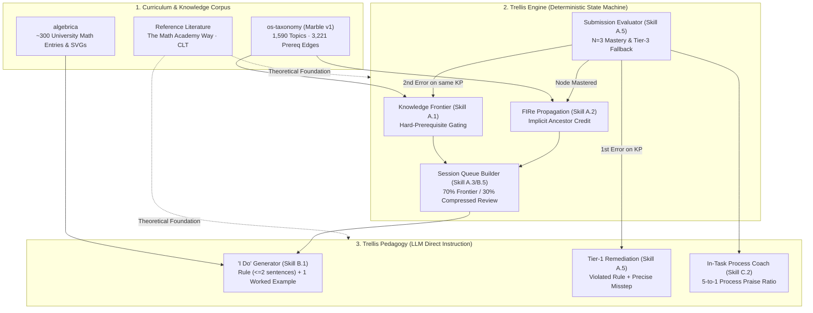
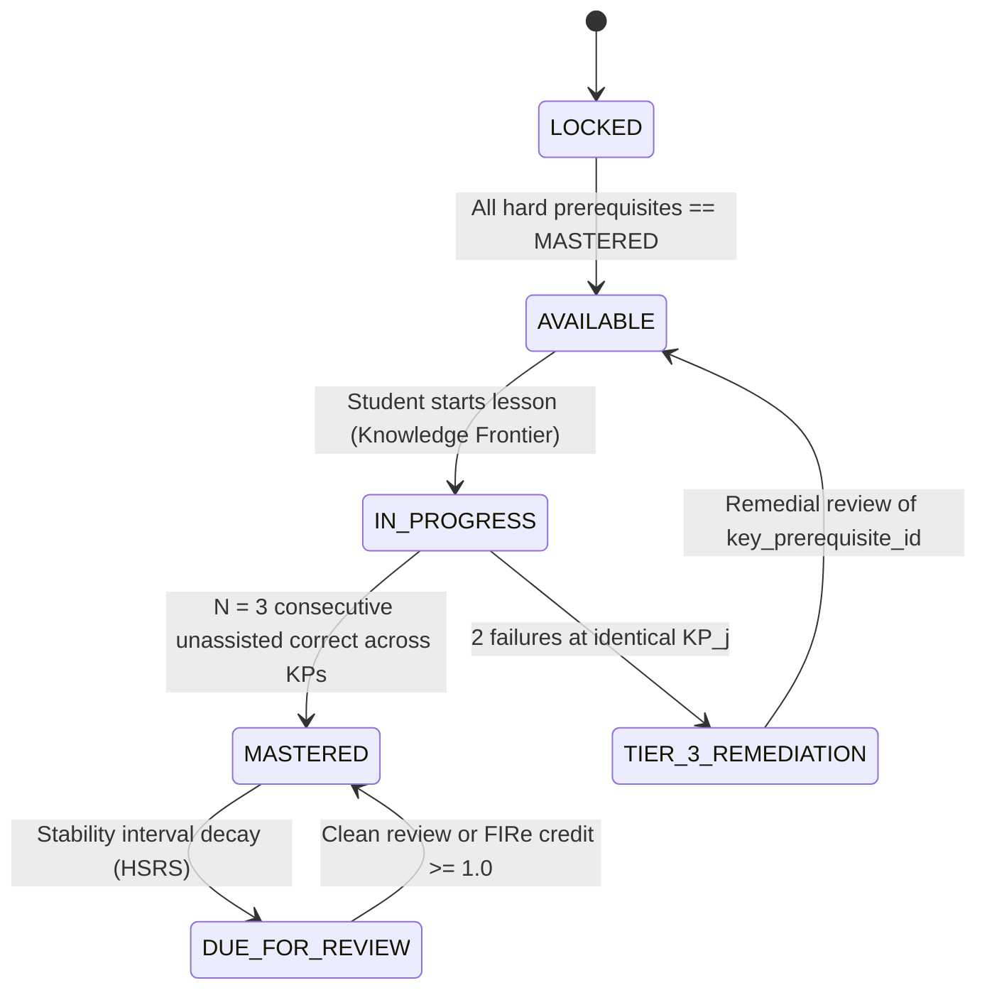
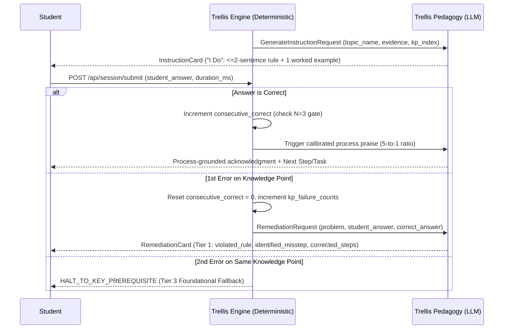

# Trellis Workspace & Codebase Overview

**Trellis** is an adaptive, mastery-based learning and instructional platform modeled on **Cognitive Load Theory (CLT)** and **The Math Academy Way**. The architecture enforces a strict separation of concerns between a **deterministic mathematical state machine** (`trellis-engine`) and a **constrained LLM direct-instruction layer** (`trellis-pedagogy`), backed by structured curriculum graphs (`os-taxonomy`) and a university-level mathematical corpus (`algebrica`).

> [!IMPORTANT]
> **Core Architectural Mandate:** All learning state transitions, spaced-repetition intervals, session queue sequences, and XP/mastery calculations are governed strictly by deterministic algorithms. Probabilistic LLMs are restricted exclusively to generating worked demonstrations, step-level error remediation, and process-grounded coaching copy.

---

## 1. System Architecture Overview

---

## 2. Repository Structure & Status

| Path | Role | Current Status |
| :--- | :--- | :--- |
| [`.agents/skills/trellis-engine/`](.agents/skills/trellis-engine/SKILL.md) | Deterministic state machine specs, JSON contracts, and algorithm pseudocode | **Specified** (Ready for code implementation) |
| [`.agents/skills/trellis-pedagogy/`](.agents/skills/trellis-pedagogy/SKILL.md) | LLM prompt templates, cognitive load constraints, and request/response contracts | **Specified** (Ready for code implementation) |
| [`os-taxonomy/`](os-taxonomy/README.md) | Marble Skill Taxonomy (`v1`) JSON graph, JSON Schemas, and Node.js integrity validator | **Complete & Validated** |
| [`algebrica/`](algebrica/README.md) | Markdown/LaTeX university math knowledge base (~300 entries + editable SVGs) | **Complete Corpus** |
| [`The Math Academy Way.md`](The%20Math%20Academy%20Way.md) | Full-text Markdown conversion of *The Math Academy Way* (3.4 MB) + [PDF](The%20Math%20Academy%20Way.pdf) | **Reference Document** |
| [`cognitive load theory-main.pdf`](cognitive%20load%20theory-main.pdf) | Cognitive Load Theory reference manual | **Reference Document** |
| [`PRD.md`](PRD.md), [`ARCHITECTURE.md`](ARCHITECTURE.md), [`DATA.md`](DATA.md), [`AGENTS.md`](AGENTS.md), [`SECURITY.md`](SECURITY.md) | Top-level project documentation stubs | **Empty (`0` bytes)** — awaiting population |

---

## 3. Deterministic Core: `trellis-engine`

Defined across [SKILL.md](.agents/skills/trellis-engine/SKILL.md), [cheatsheet.md](.agents/skills/trellis-engine/cheatsheet.md), [contracts.md](.agents/skills/trellis-engine/contracts.md), and [patterns.md](.agents/skills/trellis-engine/patterns.md), the engine models the curriculum as a Directed Acyclic Graph $G = (V, E)$.

### 3.1 Topic Node State Machine

### 3.2 Core Algorithms & Mathematical Constants

* **Knowledge Frontier Calculation ([patterns.md](.agents/skills/trellis-engine/patterns.md#L3-L31)):** Scans $G$ and unlocks `LOCKED` topics to `AVAILABLE` strictly when every incoming edge with `strength == "hard"` has `status == "MASTERED"`.
* **Fractional Implicit Repetition — FIRe ([patterns.md](.agents/skills/trellis-engine/patterns.md#L33-L69)):** Completing a node adds $+1.0$ credit to the node itself and propagates implicit review credit up to **2 hops backward** to `MASTERED` ancestors:
  * **Hop 1 (Direct Parents):** $\Delta C = w_1$ (default $w = 0.5$ for `hard` edges, $0.2$ for `soft` edges).
  * **Hop 2 (Grandparents):** $\Delta C = w_1 \times w_2$ (default $0.25$).
  * When `cumulative_fire_credit` $\ge 1.0$, the topic's stability interval expands:
    $$I_{k+1} = I_k \times \left(1.0 + 0.5 \cdot \frac{\text{student\_ability}}{\text{topic\_difficulty}}\right)$$
* **Review Compression & Micro-Interleaving ([patterns.md](.agents/skills/trellis-engine/patterns.md#L71-L103)):**
  * Prunes due reviews that are ancestors of other due reviews in the queue.
  * Targets a **70% Frontier / 30% Spaced Review** split and interleaves tasks across distinct domains to prevent blocked practice.
* **Submission Evaluation & Remediation Failsafe ([patterns.md](.agents/skills/trellis-engine/patterns.md#L105-L139)):**
  * Requires $N = 3$ consecutive unassisted correct answers per Knowledge Point (`kp_index`) to advance.
  * **1st failure on $\text{KP}_j$:** Resets `consecutive_correct = 0` and triggers **Tier-1 Corrective Remediation**.
  * **2nd failure on $\text{KP}_j$:** Halts the lesson (`HALT_TO_KEY_PREREQUISITE`, Tier 3) and routes the student to `key_prerequisite_id`.
* **Automaticity & XP Economy ([cheatsheet.md](.agents/skills/trellis-engine/cheatsheet.md#L11-L20)):**
  * Atomic fact retrieval must complete in $\le 3000\text{ ms}$ ($3.0\text{ s}$).
  * Idle timeout freezes XP if interaction latency exceeds $3 \times \text{median\_latency}$.
  * **1 XP $\approx$ 1 minute** of focused effort (Frontier lesson: $3\text{–}5\text{ XP}$; Review: $2\text{–}4\text{ XP}$; Diagnostic item: $1\text{ XP}$).

### 3.3 Core Data Contracts ([contracts.md](.agents/skills/trellis-engine/contracts.md))
* **`TopicNode` & `DependencyEdge`:** Extends `os-taxonomy` nodes/edges with `key_prerequisite_id` and `encompassing_weight`.
* **`StudentTopicState`:** Tracks `status`, `consecutive_correct`, `current_kp_index`, `kp_failure_counts`, `stability_interval_days`, `due_review_at`, and `cumulative_fire_credit`.
* **`StudentProfile`:** Tracks `xp_total`, `progress_pct`, `daily_xp_target`, and `rolling_latency_ms`.
* **Submission Endpoint (`POST /api/session/submit`):** Accepts `{ topic_id, kp_index, problem_id, student_answer, duration_ms }` and returns `{ correct, consecutive_correct, kp_completed, node_mastered, xp_awarded, tier_remediation, next_action }`.

---

## 4. Direct Instruction Layer: `trellis-pedagogy`

Defined across [SKILL.md](.agents/skills/trellis-pedagogy/SKILL.md), [cheatsheet.md](.agents/skills/trellis-pedagogy/cheatsheet.md), [contracts.md](.agents/skills/trellis-pedagogy/contracts.md), and [patterns.md](.agents/skills/trellis-pedagogy/patterns.md), this layer governs how the LLM generates instructional material and feedback.

### Pedagogical Invariants
1. **Strict Cognitive Load Budget ([cheatsheet.md](.agents/skills/trellis-pedagogy/cheatsheet.md#L3-L11)):**
   * Maximum of **4 novel chunks** per Knowledge Point (`KP_1`: canonical baseline, `KP_2`: edge/negative/fractional cases, `KP_3`: multi-step or inversion).
   * Rule statements (`rule_statement`) are capped at **2 sentences** (`InstructionCard` contract in [contracts.md](.agents/skills/trellis-pedagogy/contracts.md#L17-L32)).
   * **Expertise Reversal Trigger:** Students with $>85\%$ diagnostic accuracy bypass worked examples and go directly to unassisted verification.
2. **Ban on Socratic Inquiry for Novices ([patterns.md](.agents/skills/trellis-pedagogy/patterns.md#L20-L23)):**
   * Open-ended questions (*"What do you notice?"*, *"Why do you think that failed?"*) are strictly prohibited.
   * Errors trigger an immediate `RemediationCard` ([contracts.md](.agents/skills/trellis-pedagogy/contracts.md#L45-L56)) stating the `violated_rule`, `identified_misstep`, `corrected_steps`, and `boxed_answer`.
3. **5-to-1 Process Praise & Zero Tolerance for Slips ([patterns.md](.agents/skills/trellis-pedagogy/patterns.md#L55-L71)):**
   * Bans hollow cheerleading (*"Great job!"*, *"Math wizard!"*) in favor of specific operational acknowledgments.
   * Computational slips are never excused as "silly mistakes"—they reset the mastery counter and queue a fresh problem variant.

---

## 5. Curriculum Graph & Content Datasets

### 5.1 Marble Skill Taxonomy (`os-taxonomy/`)
A zero-dependency JSON dataset representing a prerequisite DAG for primary/elementary education ([README.md](os-taxonomy/README.md), [manifest.json](os-taxonomy/data/manifest.json)):
* **[`data/topics.json`](os-taxonomy/data/topics.json)** (Schema: [topics.schema.json](os-taxonomy/schema/topics.schema.json)): **1,590 micro-topics** across 8 subjects (**Science:** 547, **Mathematics:** 503, **English:** 286, **History:** 90, **Personal & Social Development:** 88, **Life Skills:** 37, **Computing:** 21, **Learning to Learn:** 18). Each node carries `id` (`mt_...`), `type` (`CONCEPTUAL`, `PROCEDURAL`, `REPRESENTATIONAL`, `LANGUAGE`, `META`), `ageRangeStart`/`End`, `centrality`, `evidence` criteria, `assessmentPrompt`, and `standards`.
* **[`data/dependencies.json`](os-taxonomy/data/dependencies.json)** (Schema: [dependencies.schema.json](os-taxonomy/schema/dependencies.schema.json)): **3,221 directed edges** (`topicId` depends on `prerequisiteId`), tagged with `strength` (`"hard"` or `"soft"`) and a human-readable `reason`.
* **[`data/curriculum-standards.json`](os-taxonomy/data/curriculum-standards.json)** & **[`data/clusters.json`](os-taxonomy/data/clusters.json)**: **3,261 standards** across 7 curricula and **183 domain clusters**.
* **[`scripts/validate.mjs`](os-taxonomy/scripts/validate.mjs)**: An executable Node.js integrity script (`node scripts/validate.mjs`) that verifies counts, ID formats, enum types, DAG edge referential integrity, topic-to-standard links, the `codesOnlySources` copyright invariant, and SHA-256 file checksums against [manifest.json](os-taxonomy/data/manifest.json).

### 5.2 Algebrica Knowledge Base (`algebrica/`)
A comprehensive, university-level mathematics corpus ([algebrica/README.md](algebrica/README.md)) containing ~300 rigorously structured entries in Markdown/LaTeX with editable SVG diagrams across 24 topic directories:
* **Foundations & Algebra:** `sets-and-numbers`, `logic`, `algebraic-structures`, `category`, `polynomials`, `powers-radicals-logarithms`, `equations`, `inequalities`, `complex-numbers`, `linear-systems`, `vectors-and-matrices`
* **Geometry & Trigonometry:** `lines-planes-conic-sections`, `trigonometry`
* **Analysis & Calculus:** `functions`, `sequences`, `series`, `limits`, `derivatives`, `differential-calculus-theorems`, `integrals` (e.g., [definite-integrals.md](algebrica/integrals/definite-integrals.md), [integration-strategies.md](algebrica/integrals/integration-strategies.md)), `differential-equations`
* **Applied & Probability:** `probability-and-statistics`, `kinematics`, `various`
